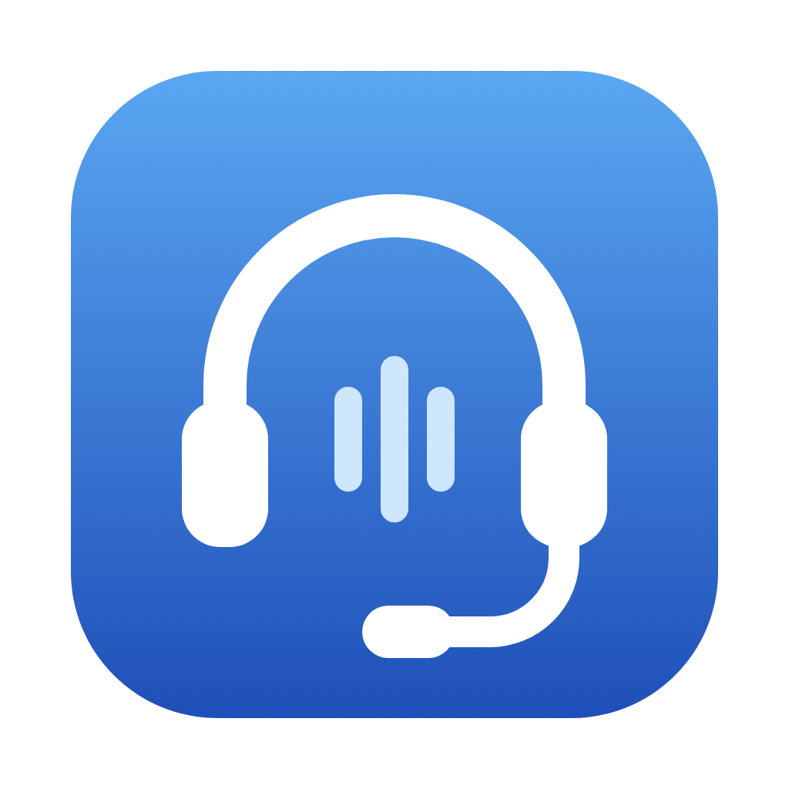
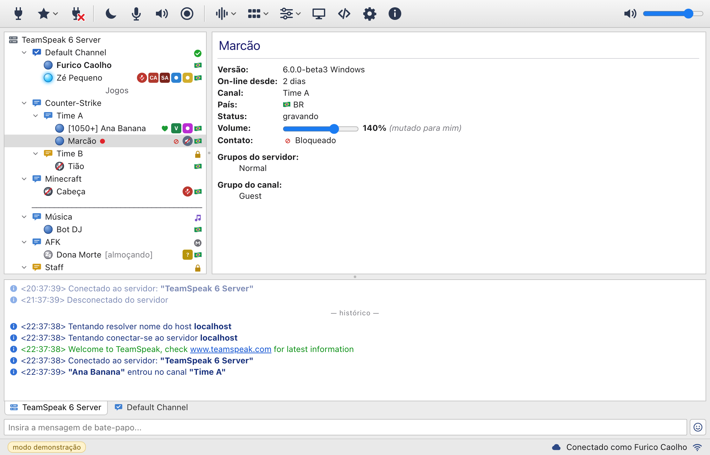
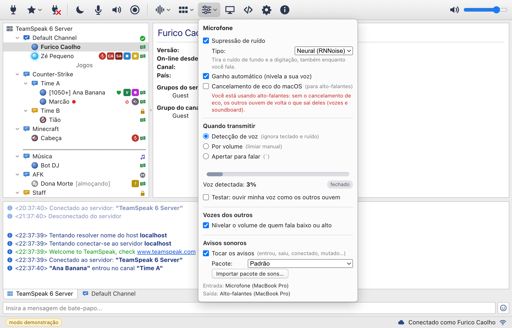
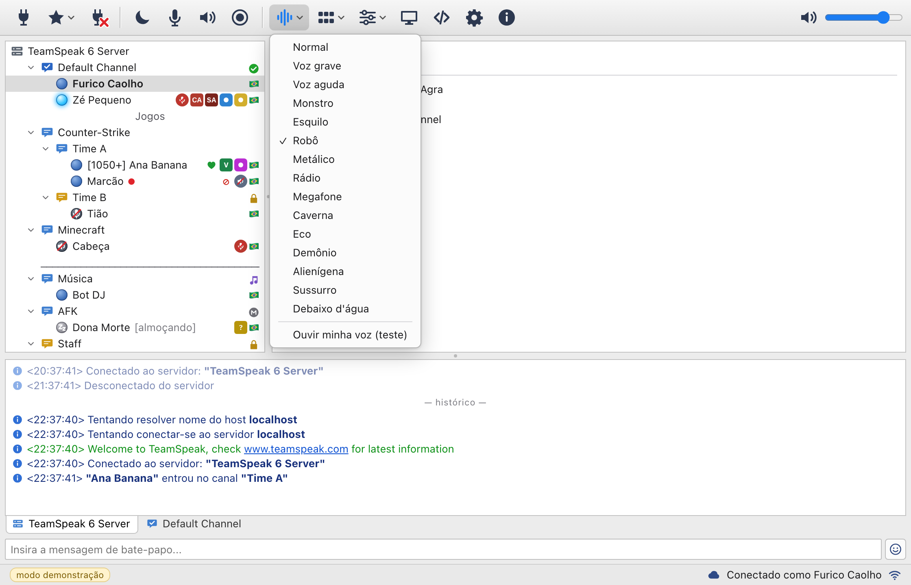
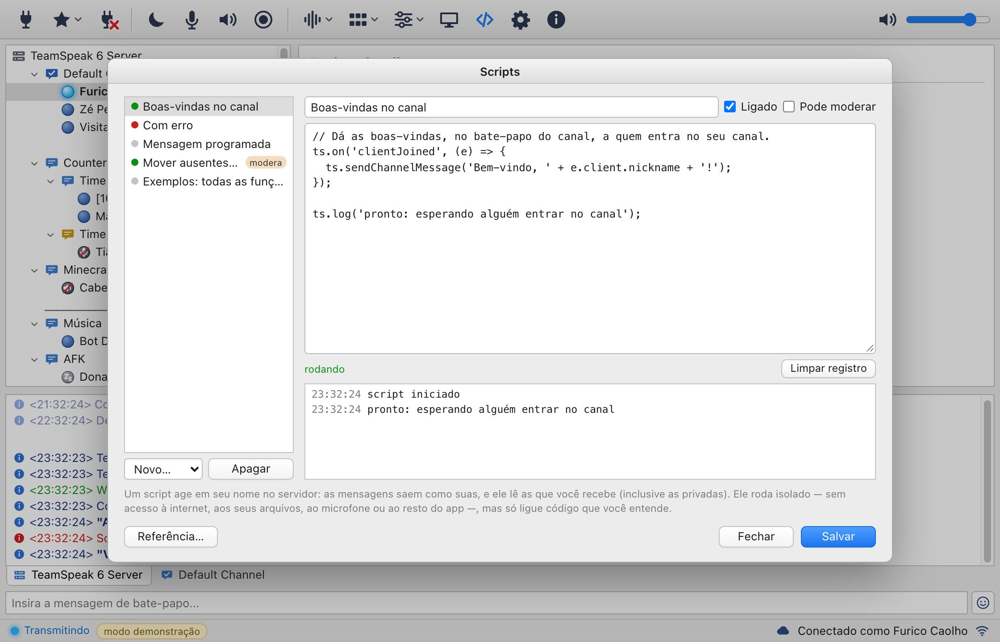
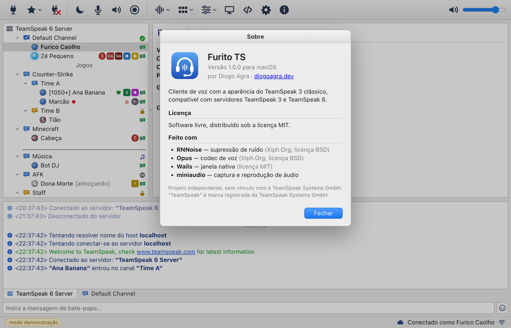
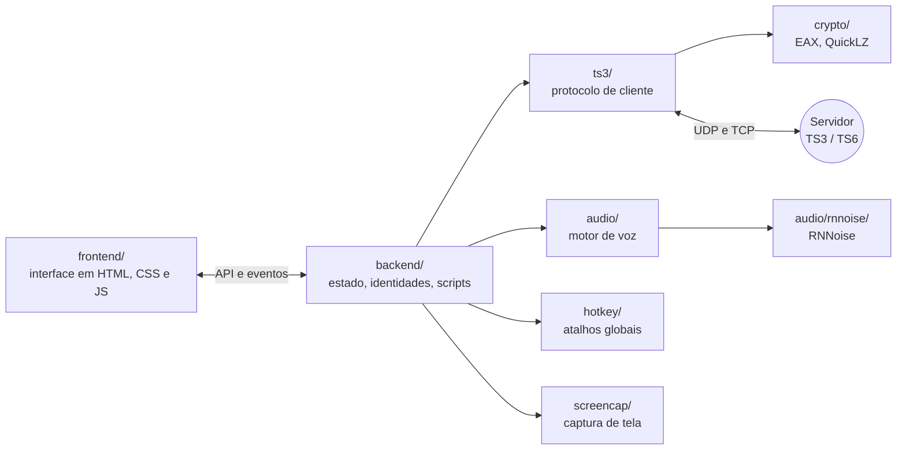

<p align="center">
  
</p>

<h1 align="center">Furito TS</h1>

<p align="center">
  Cliente de voz para macOS e Windows com a aparência do TeamSpeak 3 clássico,<br>
  compatível com servidores TeamSpeak 3 e TeamSpeak 6.
</p>

<p align="center">
  por <a href="https://diogoagra.dev">Diogo Agra</a>
</p>

<p align="center">
  
  
  
  
</p>

> **In English:** Furito TS is an independent voice chat client for
> macOS and Windows that speaks the TeamSpeak 3/6 client protocol. It has the
> classic TeamSpeak 3 look, neural noise suppression, voice changers, a
> soundboard, screen sharing and JavaScript automations. The app and its
> documentation are in Brazilian Portuguese.

<p align="center">
  
</p>

## Índice

- [Recursos](#recursos)
- [Estado do projeto](#estado-do-projeto)
- [Compilar e rodar](#compilar-e-rodar)
  - [Requisitos](#requisitos)
  - [macOS](#macos)
  - [Windows](#windows)
  - [Alvos do Makefile](#alvos-do-makefile)
- [Desenvolvimento](#desenvolvimento)
- [Arquitetura](#arquitetura)
- [Documentação](#documentação)
- [Licença e créditos](#licença-e-créditos)

## Recursos

**Voz**

- Opus em banda cheia a 64 kbit/s, com correção de erros; na recepção, buffer
  de jitter adaptativo por pessoa e reconstrução de pacotes perdidos.
- **Supressão de ruído neural** ([RNNoise](https://gitlab.xiph.org/xiph/rnnoise)),
  que tira ventilador, digitação e cliques também no meio da fala; a
  supressão espectral clássica continua disponível.
- **Detecção de voz** que junta a rede neural com medidas de tom e de
  sustentação: o teclado não abre o microfone, e o começo e o fim das frases
  chegam inteiros. Também há ativação por volume e apertar para falar.
- Ganho automático, cancelamento de eco do macOS, volume e "mutar só para
  mim" por pessoa, nivelamento do volume das outras vozes.
- **Gravação da conversa** em WAV.

**Vozes e sons**

- **14 vozes modificadas** — grave, aguda, monstro, demônio, robô, sussurro,
  rádio, megafone e outras —, com o tom e a "cor" da voz mudados
  separadamente, para soar como outra pessoa e não como uma fita acelerada.
- **Soundboard** com os seus arquivos (MP3, WAV, M4A, AIFF, FLAC…), cada som
  com atalho global.
- Avisos sonoros próprios ("entrou", "saiu", "conectado", "mutado"…), feitos de
  tons gerados por código.

**Tudo o que se espera de um cliente TeamSpeak**

- Árvore de canais com ícones, grupos, bandeiras e avatares; bate-papo de
  canal, de servidor e privado, com BBCode e histórico.
- Várias identidades (importa as do TeamSpeak 3), favoritos, reconexão
  automática, sussurro para um cliente ou um canal.
- Moderação e administração: mover, expulsar, banir, cutucar, dar a palavra;
  criar e editar canais; grupos e permissões; arquivos do canal.
- Atalhos globais de teclado, que funcionam com o app em segundo plano.

**Além do cliente original**

- **Compartilhamento de tela** entre clientes Furito, direto de um computador
  ao outro (WebRTC), em qualquer servidor TeamSpeak.
- **Scripts em JavaScript** para automatizar o dia a dia — dar boas-vindas,
  responder a comandos, mover quem está ausente —, isolados do resto do
  sistema e sem acesso à rede.

<p align="center">
  
  
</p>
<p align="center">
  
  
</p>
<p align="center"><sub>Capturas feitas no modo demonstração (backend simulado).</sub></p>

## Estado do projeto

| | |
|---|---|
| **macOS** | Plataforma principal. Desenvolvido e testado em Apple Silicon; pede macOS 12.3 ou mais novo. |
| **Windows** | O executável é gerado por compilação cruzada e depende só de DLLs do próprio Windows, mas ainda não foi validado em uso: experimental. Detalhes em [docs/windows.md](docs/windows.md). |
| **Servidores** | TeamSpeak 3 e [TeamSpeak 6 Server](https://github.com/teamspeak/teamspeak6-server). |

O app é de uma conexão por vez e ainda não tem tudo o que o cliente original
tem; veja as [limitações conhecidas](docs/limitacoes.md) e o
[roadmap](docs/roadmap.md).

## Compilar e rodar

### Requisitos

| Ferramenta | Versão | Para quê |
|---|---|---|
| [Go](https://go.dev/dl) | 1.26 ou mais novo | Compilar o app |
| [Wails](https://wails.io) | v2.16 | Janela nativa e empacotamento |
| Xcode Command Line Tools | — | Compilador C/Objective-C (macOS) |
| `pkg-config`, `opus`, `opusfile` | — | Codec de voz |
| `ffmpeg` | opcional | Arquivos OGG/Opus no soundboard |

O RNNoise já vem no repositório e é compilado junto: não há mais nada a
instalar para a supressão de ruído.

### macOS

```sh
# 1. ferramentas
xcode-select --install
brew install go pkg-config opus opusfile
go install github.com/wailsapp/wails/v2/cmd/wails@v2.16.0

# 2. dentro da pasta do projeto
make run
```

O `make run` gera `build/bin/Furito TS.app` e o abre. Na primeira
conexão o macOS pede a permissão de microfone; no primeiro compartilhamento
de tela, a de Gravação de Tela.

Para levar o app a outro Mac:

```sh
make mac-dist
```

Ele sai com as bibliotecas de áudio dentro, mais um `.zip` em `build/bin/`.
Duas coisas a saber: o app tem assinatura local (não é assinado pela Apple),
então no outro Mac a primeira abertura é com botão direito → Abrir; e as
bibliotecas do Homebrew são compiladas para o macOS em que foram instaladas —
o script informa a versão mínima que resultou.

> Se o `wails` não for encontrado ao rodar `make dev`, ponha a pasta de
> binários do Go no `PATH`: `export PATH="$PATH:$(go env GOPATH)/bin"`. Os
> scripts de compilação já fazem isso sozinhos.

### Windows

O caminho testado é a compilação cruzada a partir do macOS (ou do Linux):

```sh
brew install mingw-w64 pkg-config zstd   # compilador para Windows e utilitários
make windows-deps                        # uma vez: baixa libopus, opusfile e libogg do MSYS2 (conferidos por SHA-256)
make windows                             # gera build/bin/Furito TS.exe
```

O executável é ligado estaticamente e precisa só do WebView2, que já vem no
Windows 10 e 11. Se o `osslsigncode` estiver instalado, o `make windows`
também assina o executável (por padrão com um certificado autoassinado, que o
Windows só aceita onde ele for instalado como confiável).

Compilar no próprio Windows, pelo MSYS2, e assinar com um certificado comprado
estão descritos em [docs/windows.md](docs/windows.md).

### Alvos do Makefile

| Comando | O que faz |
|---|---|
| `make run` | Gera o app do macOS e abre |
| `make dev` | Modo desenvolvimento: recompila e recarrega a interface ao salvar |
| `make mac` | Gera `build/bin/Furito TS.app` para este Mac |
| `make mac-dist` | App com as bibliotecas de áudio dentro, mais um `.zip` |
| `make windows-deps` | Baixa as bibliotecas de áudio para Windows (uma vez) |
| `make windows` | Gera `build/bin/Furito TS.exe` |
| `make test` | `go vet` e os testes, com o detector de corrida |
| `make test-live` | Testes contra um servidor de verdade (padrão: `127.0.0.1:9987`) |

## Desenvolvimento

```sh
make dev     # o app com recarga automática
make test    # tudo o que roda sem servidor
```

A interface é HTML/CSS/JS puro, sem etapa de build, e abre num navegador com
um backend simulado — bom para mexer no visual sem compilar nada:

```sh
python3 -m http.server 8765 --directory frontend
# http://127.0.0.1:8765/index.html?mock
```

Para os testes contra um servidor, um TeamSpeak 6 descartável:

```sh
docker run -d --name teamspeak-server -e TSSERVER_LICENSE_ACCEPTED=accept \
  -p 9987:9987/udp -p 30033:30033/tcp teamspeaksystems/teamspeak6-server:latest
make test-live
```

O guia completo — estrutura das pastas, variáveis de ambiente, testes ao
vivo, avaliações de áudio e o modo demonstração — está em
[docs/desenvolvimento.md](docs/desenvolvimento.md).

## Arquitetura

O app é um executável em Go com a interface numa janela nativa
([Wails](https://wails.io)): no macOS, WKWebView; no Windows, WebView2.



O caminho da voz, do microfone à rede:

```
microfone → passa-altas → supressão de ruído → ganho automático → detecção de voz
          → voz modificada → soundboard → limitador → Opus → servidor
```

## Documentação

| Guia | Conteúdo |
|---|---|
| [Áudio](docs/audio.md) | Supressão de ruído, detecção de voz, vozes, soundboard, avisos e como medir cada parte |
| [Uso diário e administração](docs/uso.md) | Atalhos, identidades, moderação, ícones e avatares, onde ficam os dados |
| [Compartilhamento de tela](docs/compartilhamento-de-tela.md) | Como funciona, privacidade e limites |
| [Scripts](docs/scripts.md) | A API das automações e o que protege o sistema delas |
| [Segurança](docs/seguranca.md) | De quem o app se defende, como, e o que fica de fora |
| [Windows](docs/windows.md) | Estado do porte, compilação e assinatura |
| [Desenvolvimento](docs/desenvolvimento.md) | Estrutura, testes, variáveis de ambiente, modo demonstração |
| [Limitações conhecidas](docs/limitacoes.md) | O que ainda não funciona ou funciona com ressalvas |
| [Roadmap](docs/roadmap.md) | O que está planejado |

## Licença e créditos

Feito por [Diogo Agra](https://diogoagra.dev). O código do projeto é
distribuído sob a [licença MIT](LICENSE).

Ele inclui o [RNNoise](https://gitlab.xiph.org/xiph/rnnoise) (Xiph.Org, BSD)
e usa [Opus](https://opus-codec.org), [Wails](https://wails.io) e
[miniaudio](https://miniaud.io), entre outros; a lista, com as licenças, está
em [THIRD_PARTY_NOTICES.md](THIRD_PARTY_NOTICES.md).

**Aviso.** Este é um projeto independente, sem vínculo com a TeamSpeak
Systems GmbH, que não o patrocina nem endossa. "TeamSpeak" é marca registrada
da TeamSpeak Systems GmbH. Nenhum arquivo do cliente TeamSpeak faz parte
deste repositório: os avisos sonoros, por exemplo, são gerados pelo próprio
app.
