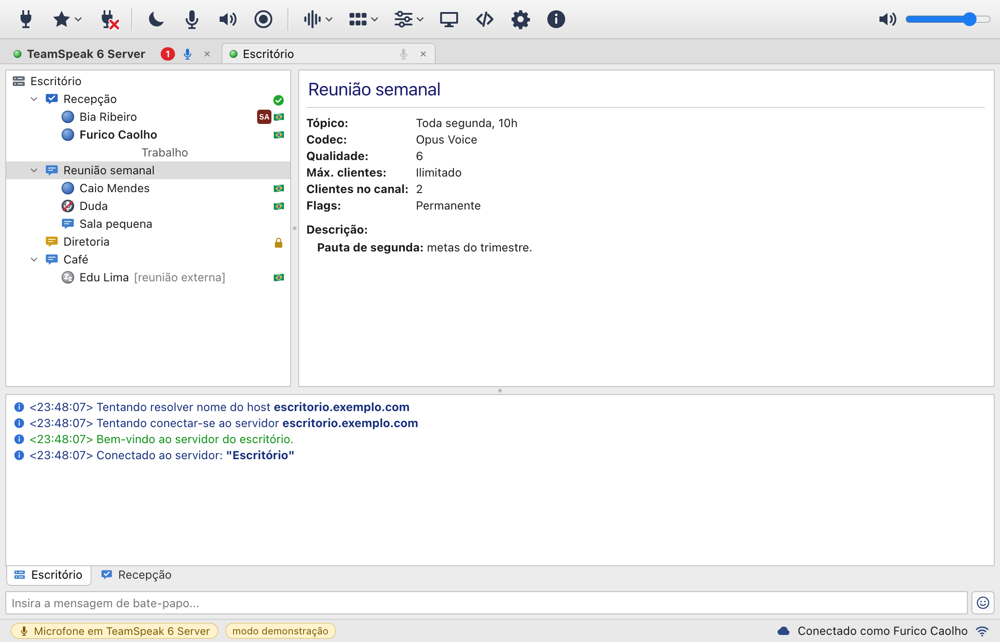

# Uso diário e administração

O que o app faz além da voz: atalhos, identidades, moderação, arquivos, ícones
e onde ficam os dados.

## Recursos do dia a dia

- **Apertar para falar e atalhos globais** (`hotkey/`): funcionam com o app em
  segundo plano, pelos atalhos globais do macOS (não pedem permissão de
  Acessibilidade). Limite do sistema: precisa ser uma tecla de função ou uma
  combinação com Ctrl/Alt/Cmd — tecla modificadora sozinha e botão do mouse
  não dá.
- **Dispositivos de áudio** escolhidos por nome; **volume por pessoa**, "mutar
  só para mim" e **contatos** (amigo/bloqueado) ficam guardados pela
  identidade de cada pessoa.
- **Favoritos** e **reconexão automática**: quando a conexão cai, tenta de
  novo com espera crescente e volta ao canal em que você estava; não insiste
  se você foi expulso ou banido.
- **Identidades**: várias, como no TeamSpeak 3 (Ajustes → Identidades): criar,
  renomear, escolher a padrão, apagar, exportar e importar — também o `.ini`
  exportado pelo cliente TeamSpeak 3 (Ferramentas → Identidades), de onde vêm o
  nome e o apelido. A janela de conexão e cada favorito podem usar uma
  identidade diferente da padrão. Servidores TeamSpeak 6 mostram um UID mais
  longo (SHA-256 da mesma chave) que o do TS3 (SHA-1); os Ajustes mostram os
  dois. Também: aumentar o nível de segurança; a chave de privilégio fica em
  Ajustes → Conexão.
- **Sobre** (botão "i" da barra, ao lado dos Ajustes, ou Ajuda → Sobre): a
  versão do app, o autor, a licença e os créditos.
- **Versão**: entre clientes Furito a versão aparece como "Furito TS 1.0.1".
  Para o servidor e para os clientes oficiais continua "3.?.? [Build:
  5680278000] Linux": o servidor confere a assinatura da TeamSpeak sobre a
  versão e recusa qualquer outro texto ("client is modified").
- **Histórico** das conversas de canal e de servidor é
  salvo por servidor em `~/Library/Application Support/FuritoTS/history/`.
- **Moderação**: mover, expulsar (canal/servidor), banir, cutucar, dar e pedir
  a palavra. Uma cutucada recebida abre uma janela, toca o aviso sonoro e
  aparece no registro do servidor; em Ajustes → Conexão dá para desligar a
  janela e ficar só com o som e o registro. **Canais**: criar, editar, apagar. **Grupos**: atribuir grupos de
  servidor e de canal; ver e editar as permissões de um grupo.
- **Sussurro** para um cliente ou um canal; **arquivos do canal** (listar,
  baixar, enviar, criar pasta, apagar).

Cada ação espera a confirmação do servidor e mostra o erro dele (por exemplo
"permissão insuficiente") em vez de falhar em silêncio.

As janelas internas (Ajustes, Favoritos, cutucada, permissões…) são painéis
dentro da janela do app: arrastam pelo título, sempre cabem na janela (o miolo
rola; título e botões ficam à vista) e voltam ao centro a cada abertura.

Os **Ajustes** têm uma aba por assunto — Áudio, Atalhos, Conexão,
Privacidade, Tela e Identidades — e reabrem na última aba usada. O que mexe
no som enquanto você fala (supressão de ruído, sensibilidade, cancelamento de
eco, avisos sonoros) fica no painel do microfone, junto do medidor; a aba
Áudio tem um botão que leva até ele.

## Vários servidores ao mesmo tempo

Cada servidor fica numa aba. A barra de abas aparece quando há duas ou mais.

- **Abrir:** na janela de conexão, marque "Em nova aba" (ou Conexões →
  Conectar em nova aba…, Cmd/Ctrl+T); nos favoritos, "Conectar em nova aba".
  Sem isso, conectar troca o servidor da aba atual, como sempre foi. Uma aba
  desconectada é reaproveitada, para não sobrar aba vazia.
- **Trocar:** clique na aba, Ctrl+Tab e Ctrl+Shift+Tab, Cmd/Ctrl+1…9, ou
  Conexões → Próxima aba / Aba anterior. Cada aba guarda a sua seleção, o seu
  bate-papo e o rascunho da mensagem.
- **Fechar a aba** (o × dela, clique do meio, ou Conexões → Fechar aba) sai
  daquele servidor, pedindo confirmação se você está conectado. A última aba
  não some: fica desconectada.
- **Ouvir:** todas as abas tocam ao mesmo tempo. "Silenciar este servidor", no
  menu da aba, cala um servidor sem sair dele; ele mostra você com os
  alto-falantes mutados.
- **Falar:** em um servidor por vez, o da aba com o ícone do microfone. A
  primeira conexão fica com o microfone e uma aba nova não o toma: para falar
  em outro servidor, clique no microfone esmaecido da aba dele (ou "Falar
  neste servidor", no menu da aba). Nos
  servidores em que você não fala, os outros veem o seu microfone como
  desativado. Se você sair do servidor em que falava, o microfone só muda
  sozinho quando sobra um único servidor; com dois ou mais, a barra de estado
  avisa e a escolha é sua — assim a sua voz nunca vai para um servidor que
  você não escolheu. O soundboard e o apertar para falar acompanham o
  microfone.
- **Mutar o microfone, mutar os alto-falantes e ausente** valem para todos os
  servidores de uma vez.
- **Avisos sonoros:** a aba à vista toca todos. Das outras só toca o que é com
  você: cutucada, ser movido, expulso ou banido, a conexão cair ou voltar.
- **Mensagens:** o que chega no bate-papo de uma aba fora da vista aparece
  como contador na aba.
- **De cada aba:** identidade, reconexão automática, histórico, sussurro,
  gravação da conversa (uma por vez; grava as vozes daquele servidor e a sua
  enquanto você fala nele) e compartilhamento de tela.

## Ícones, avatares e descrições

- Os ícones à direita do apelido (grupo do canal, grupos do servidor, ícone do
  cliente) são imagens guardadas no servidor, baixadas pela transferência de
  arquivos do TeamSpeak (`ts3/filetransfer.go`, porta TCP 30033 por padrão) e
  guardadas em `~/Library/Application Support/FuritoTS/icons/`.
- Descrições de canal mostram `[img]` como imagem, além de `[center]`,
  `[size]`, `[hr]` e listas. Buscar uma imagem mostra o seu endereço IP ao
  site que a hospeda, então ela não carrega sozinha: aparece um marcador
  ("Imagem de *site* — clique para carregar"), e "Carregar sempre as imagens
  deste servidor" libera o servidor de uma vez. Em Ajustes → Privacidade →
  *Imagens de fora* dá para carregar sempre (como o cliente original) ou
  nunca. Em mensagens e cutucadas, `[img]` vira só o endereço. Os motivos
  estão em [seguranca.md](seguranca.md).
- **Avatares**: quem tem um avatar aparece com ele nas informações do cliente
  (bloco "Avatar", desenhado como as imagens das descrições). O servidor avisa
  que o cliente tem avatar por uma marca (`client_flag_avatar`, o MD5 do
  arquivo); a imagem é baixada do servidor, pela transferência de arquivos,
  só quando as informações da pessoa são abertas, e fica guardada em
  `avatars/` na pasta de dados — quando a pessoa troca o avatar, a marca muda
  e a imagem nova é buscada. O app só mostra avatares; ainda não tem como
  definir o seu.

## Dados locais

- Identidades: `~/.ts_furito_identity.json` (não apague: são as chaves que os servidores usam para reconhecer você). O arquivo do formato antigo, de uma identidade só, é convertido na primeira abertura e fica copiado em `~/.ts_furito_identity.json.v1`.
- Registro: `furito.log` na mesma pasta dos ajustes (no Windows,
  `%AppData%\FuritoTS\furito.log`): passos da abertura, erros e panes.
  Se o app não abrir, o motivo está nele; no Windows também aparece numa caixa
  de mensagem.
- Scripts: `scripts.json`, na mesma pasta dos ajustes (o código de cada script e se está ligado).
- Ajustes: `~/Library/Application Support/FuritoTS/settings.json`. Não guarda senhas de servidor nem de canal; guarda, se configurada, a senha do servidor de retransmissão (TURN) do compartilhamento de tela.
